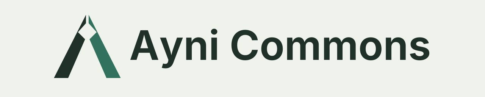

# Ayni Commons

<picture>
  <source media="(prefers-color-scheme: dark)" srcset="https://raw.githubusercontent.com/Ayni-Commons/.github/main/assets/brand/profile-banner-dark.png">
  
</picture>

### Own your hardware. Share source. Build on each other’s work.

We believe owning your hardware should mean being able to understand how it works, maintain it, and decide what it does. We share source code, designs, and documentation so you can learn from what others have built and make something of your own.

Our name comes from *ayni*, a living Andean practice of reciprocity. Neighbors help one another with work such as planting crops. In time, the people who received help return it when others need a hand. That ongoing exchange helps a community do work that would be harder for any one household to do alone. We take inspiration from it. In an open-source project, it might mean documenting a fix, helping someone adapt a design, or sharing a new design that began with somebody else’s work. [Smithsonian National Museum of the American Indian](https://americanindian.si.edu/nk360/inka-water/reciprocity/reciprocity)

We publish our project software under open-source licenses. The choice varies by project and can include permissive or copyleft licenses. Each repository carries the terms for using, modifying, and redistributing its code.

We also plan to offer optional paid services, such as hosted automation through Reyin Cloud. Revenue from those services helps pay for ongoing development, maintenance, and documentation. The project software remains available under its open-source license.

Our first projects are **Reyin**, **Giano**, and **GianOS**. Each repository’s contribution guide will explain how to report an issue, propose a change, or share what you built with it.

[Official logo files](https://github.com/Ayni-Commons/.github/tree/main/assets/brand) · [Brand-use permission](https://github.com/Ayni-Commons/.github/blob/main/BRAND-USE.md)
